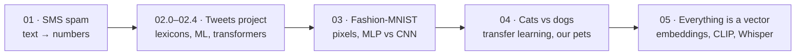

# Lesson 03 · Applied AI: unstructured data

**How does a computer read text, see images and hear sound? Text Mining, Computer Vision and a multimodal finale with embeddings, CLIP and Whisper.** Part of [The AI Learning Hub](https://github.com/the-ai-learning-hub).

📖 **[Open the Lesson 03 slides](https://the-ai-learning-hub.github.io/03-applied-ai-projects/)** · use ← → to change slides, `F` for full screen and `N` for the speaker notes.

Most of the world's data doesn't fit in a table: messages, reviews, photos, voice notes. This lesson turns each of them into numbers a model can learn from. Every area follows the same path: a **mini-project** to learn the basics on clean data, a **project** on real, messy data, and a **challenge** where you play against the models yourself.

**Prerequisites:** [Lesson 02 · Machine Learning fundamentals](https://github.com/the-ai-learning-hub/02-machine-learning-fundamentals) (train/test split, `Pipeline`, metrics, overfitting, PyTorch basics). No advanced maths: every idea comes with a picture and real numbers.

---

## The path



| # | Notebook | The question | Slides | Open |
|---|---|---|---|---|
| 01 | [Text Mining basics: SMS spam](01_text_mining/01_mini_project_sms_spam/01_Text_Mining_Basics_SMS_Spam.ipynb) | How does text become numbers? | [#sms-spam](https://the-ai-learning-hub.github.io/03-applied-ai-projects/#sms-spam) | [](https://colab.research.google.com/github/the-ai-learning-hub/03-applied-ai-projects/blob/main/01_text_mining/01_mini_project_sms_spam/01_Text_Mining_Basics_SMS_Spam.ipynb) |
| 02 | [Tweet sentiment project (02.0–02.4)](01_text_mining/02_project_tweets/02.0_Tweets_EDA.ipynb): EDA, baseline tools, lexicons, ML, transformers | Can we beat the 83% of "always say positive"? | [#tweets](https://the-ai-learning-hub.github.io/03-applied-ai-projects/#tweets) | [](https://colab.research.google.com/github/the-ai-learning-hub/03-applied-ai-projects/blob/main/01_text_mining/02_project_tweets/02.0_Tweets_EDA.ipynb) |
| 🎮 1 | [🎚️ Flip It!](01_text_mining/03_challenge_flip_it/Challenge_1_Flip_It.ipynb) | How few words must you change to make a sentiment AI change its mind? | [#challenge-1](https://the-ai-learning-hub.github.io/03-applied-ai-projects/#challenge-1) | [](https://colab.research.google.com/github/the-ai-learning-hub/03-applied-ai-projects/blob/main/01_text_mining/03_challenge_flip_it/Challenge_1_Flip_It.ipynb) |
| 03 | [Computer Vision basics: Fashion-MNIST](02_computer_vision/01_mini_project_fashion_mnist/03_Computer_Vision_Basics_Fashion_MNIST.ipynb) | An image is a grid of numbers: how does a model read it? | [#fashion](https://the-ai-learning-hub.github.io/03-applied-ai-projects/#fashion) | [](https://colab.research.google.com/github/the-ai-learning-hub/03-applied-ai-projects/blob/main/02_computer_vision/01_mini_project_fashion_mnist/03_Computer_Vision_Basics_Fashion_MNIST.ipynb) |
| 04 | [Cats vs dogs, and our pets](02_computer_vision/02_project_cats_vs_dogs/04_Cats_vs_Dogs_And_Our_Pets.ipynb) | From scratch or borrowed knowledge? Does it work on *our* animals? | [#cats-dogs](https://the-ai-learning-hub.github.io/03-applied-ai-projects/#cats-dogs) | [](https://colab.research.google.com/github/the-ai-learning-hub/03-applied-ai-projects/blob/main/02_computer_vision/02_project_cats_vs_dogs/04_Cats_vs_Dogs_And_Our_Pets.ipynb) |
| 🎮 2 | [YOLO scavenger hunt](02_computer_vision/03_challenge_yolo/Challenge_2_YOLO_Scavenger_Hunt.ipynb) | How many objects can YOLO find on your desk? | [#challenge-2](https://the-ai-learning-hub.github.io/03-applied-ai-projects/#challenge-2) | [](https://colab.research.google.com/github/the-ai-learning-hub/03-applied-ai-projects/blob/main/02_computer_vision/03_challenge_yolo/Challenge_2_YOLO_Scavenger_Hunt.ipynb) |
| 05 | [Everything is a vector](03_multimodal/01_project_everything_is_a_vector/05_Everything_Is_A_Vector.ipynb) | Can one idea connect words, photos and voices? | [#multimodal](https://the-ai-learning-hub.github.io/03-applied-ai-projects/#multimodal) | [](https://colab.research.google.com/github/the-ai-learning-hub/03-applied-ai-projects/blob/main/03_multimodal/01_project_everything_is_a_vector/05_Everything_Is_A_Vector.ipynb) |
| 🎮 3 | [CLIP Pictionary](03_multimodal/02_challenge_clip_pictionary/Challenge_3_CLIP_Pictionary.ipynb) | Can you describe a photo so CLIP finds it first? | [#challenge-3](https://the-ai-learning-hub.github.io/03-applied-ai-projects/#challenge-3) | [](https://colab.research.google.com/github/the-ai-learning-hub/03-applied-ai-projects/blob/main/03_multimodal/02_challenge_clip_pictionary/Challenge_3_CLIP_Pictionary.ipynb) |

Each area folder has its own README with details, runtimes and models: [Text Mining](01_text_mining/README.md) · [Computer Vision](02_computer_vision/README.md) · [Multimodal](03_multimodal/README.md).

### Lesson plan

| Block | Slides + notebook | Challenge |
|---|---|---|
| Opening: unstructured data, how a computer reads / sees / hears | slides | — |
| Text Mining: tokens, bag of words, TF-IDF, word vectors, metrics → a tweet project: lexicons, classic ML, transformers | notebooks 01 + 02.0–02.4 | 🎮 1 |
| Computer Vision: pixels, convolutions, CNNs → transfer learning, CPU vs GPU, Grad-CAM | notebooks 03 + 04 | 🎮 2 |
| Multimodal: embeddings, semantic search, CLIP, sound and Whisper | notebook 05 | 🎮 3 |
| Recap, responsible AI and what's next | slides | — |

Notebook 05 and the challenges are self-contained and can also be done as homework.

## What you'll be able to do

- Turn text into numbers (**tokens, bag of words, TF-IDF**) and build a **spam filter** you can test with your own messages.
- Compare **lexicons, six classic ML models and transformers** on real tweets, and pick the **metric** that matches the problem (macro-F1, not accuracy, when classes are unbalanced).
- Read an image as a **grid of pixels**, explain what a **convolution** does and why a small **CNN** beats an MLP.
- Use **transfer learning** to get ~98% on cats vs dogs in seconds on a CPU, measure the **CPU vs GPU** difference and see where the model looked with **Grad-CAM**.
- Explain **embeddings** ("everything is a vector"): semantic search, **CLIP** for text ↔ images, and **Whisper** for speech → text, with no API keys.

## Getting started

You need what you installed in [Lesson 00](https://github.com/the-ai-learning-hub/00-environment-setup): **uv**, **VS Code** (Python and Jupyter extensions) and **Git**.

```bash
git clone https://github.com/the-ai-learning-hub/03-applied-ai-projects.git
cd 03-applied-ai-projects
uv sync
code .
```

`uv sync` installs Python 3.12 and every library of this lesson (scikit-learn, PyTorch, transformers, sentence-transformers, ultralytics…) in a local `.venv`, with the exact versions of `uv.lock`. Pretrained models (a few hundred MB in total) are downloaded the first time a notebook needs them.

In VS Code, open a notebook, click **Select Kernel** → **Python Environments** → **.venv** and run the cells in order with `Shift` + `Enter`.

> **Nothing installed, or something failed?** Every notebook has an **Open in Colab** button. The first cell clones this repository into Colab, so data and shared code (`src/`) are available automatically.

> **Mac with an Intel processor?** Recent PyTorch versions only ship for Apple Silicon (M1 or newer, macOS 14+). On an Intel Mac, use the **Open in Colab** buttons instead of installing locally.

> **GPU (optional):** everything runs on a CPU. Heavy steps (fine-tuning DistilBERT, long CNN trainings) are behind `RUN_HEAVY = False` and load results we measured on an RTX 4060 Laptop GPU. In Colab: *Runtime → Change runtime type → T4 GPU*. Locally with an NVIDIA GPU, after `uv sync` run:
>
> ```bash
> uv pip install torch torchvision --index-url https://download.pytorch.org/whl/cu128
> ```
>
> (a later `uv sync` brings back the CPU build).

## Repository layout

```
03-applied-ai-projects/
├── index.html                      # slides (GitHub Pages)
├── 01_text_mining/
│   ├── 01_mini_project_sms_spam/
│   ├── 02_project_tweets/          # + results/ precomputed on GPU
│   └── 03_challenge_flip_it/
├── 02_computer_vision/
│   ├── 01_mini_project_fashion_mnist/
│   ├── 02_project_cats_vs_dogs/    # + results/ (CPU vs GPU, heavy runs, pets)
│   └── 03_challenge_yolo/          # + my_photos/
├── 03_multimodal/
│   ├── 01_project_everything_is_a_vector/
│   └── 02_challenge_clip_pictionary/
├── data/                           # datasets shipped with the lesson (see DATA_DICTIONARY.md)
├── src/                            # shared helpers: paths, plotting, text, vision, multimodal, challenges
├── assets/slides/                  # images used by the slides
└── tools/                          # run and audit the notebooks
```

## How the notebooks work

Every notebook has the same shape: 🎯 objectives, ⚙️ setup (works locally and in Colab), short sections with **🧠 How it works** boxes, ✏️ exercises with a hidden 💡 solution, 💬 discussion questions with a guide for the instructor, and a 📌 summary. They are saved **already executed**, so you can read the results on GitHub before running anything.

For maintainers:

```bash
uv run pytest -q                       # tests for src/
uv run python tools/run_notebooks.py   # execute every notebook and save outputs
uv run python tools/audit_notebooks.py # structure, links and leftovers check
uv run python -m http.server 8000      # preview the slides at http://localhost:8000
```

## Data and credits

Datasets, sources and licences are in [`data/DATA_DICTIONARY.md`](data/DATA_DICTIONARY.md): the SMS Spam Collection (UCI, CC BY 4.0), English tweets provided in the Text Mining course at ISCTE – University Institute of Lisbon, VADER, AFINN and NRC EmoLex lexicons, a subset of the Kaggle *Dogs vs. Cats* photos, Fashion-MNIST (Zalando, MIT) and **our own pets**. Models come from Hugging Face, torchvision and Ultralytics (YOLO, AGPL-3.0).

## Learn more

- [Hugging Face NLP Course](https://huggingface.co/learn/nlp-course) — tokenizers, transformers and fine-tuning, step by step.
- [scikit-learn: text feature extraction](https://scikit-learn.org/stable/modules/feature_extraction.html#text-feature-extraction) — bag of words and TF-IDF pipelines.
- [CS231n: CNNs for visual recognition](https://cs231n.github.io/) — the classic notes on convolutions.
- [PyTorch transfer learning tutorial](https://docs.pytorch.org/tutorials/beginner/transfer_learning_tutorial.html)

## License

[MIT](LICENSE).
